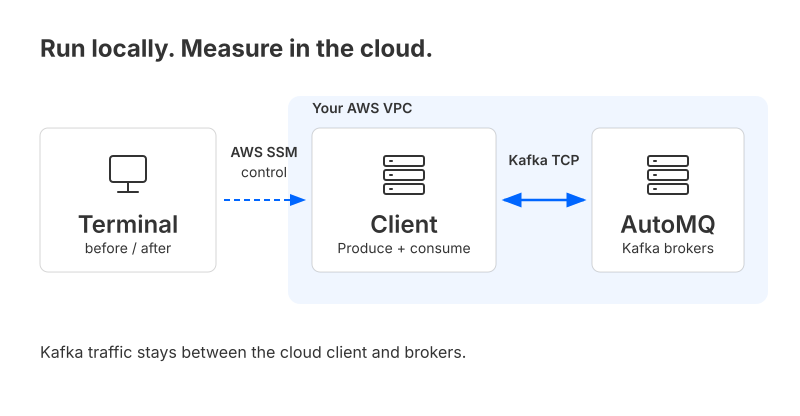
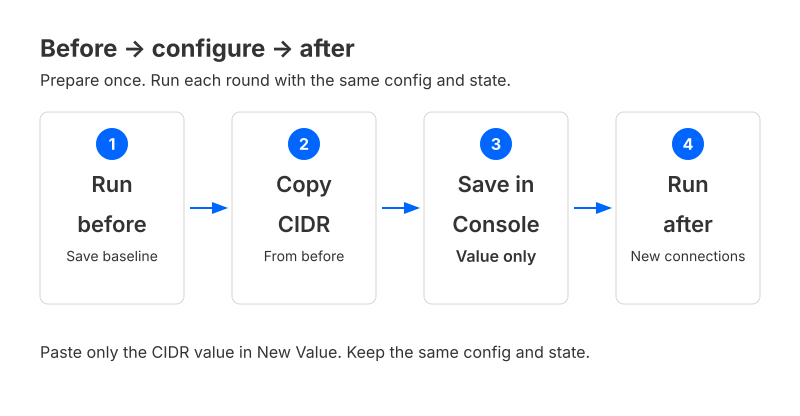
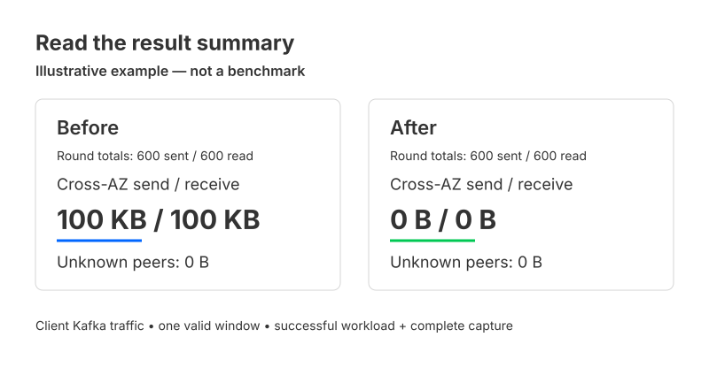

# Verify client cross-AZ traffic

Run a small Kafka workload before and after configuring AutoMQ CIDR routing. Compare the measured cross-AZ send and receive bytes in your terminal.

You run commands on your laptop. The producer, consumer and traffic capture run on your selected cloud Linux clients; Kafka traffic stays in the cloud.



## Before you start

You need an existing AutoMQ cluster that supports CIDR-based multi-AZ routing, a real Linux client in each AZ you want to test, and authorized AWS SSM access. One client tests its own AZ; three-AZ coverage needs three clients. Use a dedicated test topic.

**Complete [first-time setup](docs/setup.md) before running this guide.** It covers local tools, cloud-client prerequisites, your case/runner files, and building and installing the runtime. These steps are done once per selected client; `demo` does not deploy machines or install missing dependencies.

For a useful baseline, the selected client sources must not already match effective CIDR routing. Preserve the original configuration and use an approved test configuration or source; the tool does not clear existing settings.

## Run the comparison



### 1. Select your prepared files

From the repository root, open the case directory and set **absolute paths** to the files prepared during setup:

```sh
cd byoc-examples/clients/cross-az-verification
demo_config=/absolute/private/automq-demo/case.json
demo_state=/absolute/private/automq-demo/state
```

The supplied case has one client. To test three AZs, use the three-client template described in setup. Keep the same configuration, selected clients and state directory for both rounds.

### 2. Run before

```sh
./demo before --config "$demo_config" --state-dir "$demo_state"
```

The command checks the clients, prepares the test topic, sends and consumes data, saves a valid baseline, then stops this round's processes and removes its temporary capture environment. Topics, groups and local results are retained.

The example sends **10 KB/s per producer**, at most 600 messages or 90 seconds, whichever comes first. A normal round is expected to take about 2–3 minutes including setup and cleanup; this is an estimate, not the total timeout.

### 3. Save the CIDR value in the console

A successful before summary prints a candidate such as:

```text
automq.zone.cidr.blocks=example-az1@10.40.1.0/24
```

Use **your command's candidate**, not this example. In the intended AutoMQ instance's configuration page, select `automq.zone.cidr.blocks`. In **New Value**, paste only the value:

```text
example-az1@10.40.1.0/24
```

**Do not include `automq.zone.cidr.blocks=` in New Value.** Save and verify the complete mapping. A candidate marked as partial covers only this round's clients; preserve other sources in any existing mapping. The script does not change or read back cluster configuration.

### 4. Run after

```sh
./demo after --config "$demo_config" --state-dir "$demo_state"
```

After opens new connections, runs the same workload and compares its saved business window with before. Each consumer starts at the new round's beginning rather than replaying before's backlog. Both rounds stop and clean up automatically when successful.

You can close the terminal **after before has finished successfully**, configure CIDR, then return using the same paths. An after attempt is not silently rerun; start a new before session for another experiment.

## Read the result



The default output is one running message and a short final summary. The figure is an illustration of how to read it, not a benchmark or a promised result.

- **Cross-AZ send or receive is nonzero:** cross-AZ traffic was observed in that saved window.
- **Both are 0 B, unknown peers are 0 B, and the result is valid:** no cross-AZ TCP traffic was observed for this client in that business window.
- **Unknown, incomplete or not directly comparable:** follow the displayed reason before drawing an improvement conclusion.

These are client Kafka network bytes, including packet headers and retransmissions—not payload size or cloud billing totals. A successful command confirms execution and cleanup; it does not guarantee zero cross-AZ traffic across the cluster.

## Check status or stop early

```sh
./demo status --config "$demo_config" --state-dir "$demo_state"
./demo stop --config "$demo_config" --state-dir "$demo_state"
```

Status shows the latest phase without starting workload or extending its runtime. Stop is for early cancellation or recovery; a successful completed round needs no extra stop. Keep your state directory, especially if any stop or cleanup remains unconfirmed, and use the exact recovery commands printed by the tool.

The public launcher defaults to English. Add `--lang zh` for Chinese, or `--details` for live sampling, peer addresses and diagnostics.

## More guides

- [First-time setup and input fields](docs/setup.md)
- [Independent producer, consumer and capture controls](docs/manual.md)
- [Troubleshooting, recovery and resource cleanup](docs/operations.md)
- [Generic Kafka workload](../../../tools/kafka-workload/) and [opt-in AWS verification](docs/aws-e2e.md)
