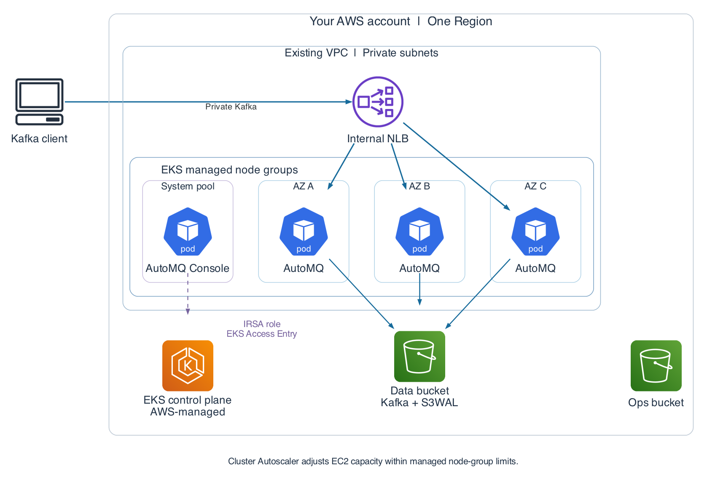

# Deploy AutoMQ on a new Amazon EKS cluster

Use this example to deploy AutoMQ BYOC in your AWS account, reuse your existing network, and connect a Kafka client to a private endpoint. Terraform prepares a new EKS cluster and installs AutoMQ Console with Helm. You then create a three-AZ Kafka Instance through Console's management API, without preparing its Data bucket, IAM role or private DNS manually.

At the end of this guide, you will have a persistent Console, a managed Kafka Instance running across three Availability Zones, and a successful Kafka produce/consume check.

This guide uses the released AWS Console image `automq.azurecr.io/automq/automq-byoc-console:8.4.13-aws` with Console Helm Chart `8.3.28`. The image runs the product; the Chart installs it. These version numbers do not need to match. Pin `console_image` to the exact released image in the [component configuration](docs/configuration.md#component-versions).

## In this guide

1. [What gets deployed](#what-gets-deployed)
2. [Before you start](#before-you-start)
3. [Parameters you need to set](#parameters-you-need-to-set)
4. [Deploy the environment](#deploy-the-environment)
5. [Connect and verify Kafka](#connect-and-verify-kafka)
6. [Scale the Instance and EKS capacity](#scale-the-instance-and-eks-capacity)
7. [Clean up](#clean-up)

For other requirements, see [configuration and deployment choices](docs/configuration.md) and [operations and troubleshooting](docs/operations.md).

## What gets deployed



The Console and Kafka Instance share the new EKS cluster but use separate node pools and identities. Applications reach Kafka through a private Network Load Balancer (NLB). Console obtains its own IAM role through IRSA. An EKS Access Entry grants that role permission to manage Kubernetes resources in this cluster. Each Instance has its own Pod role, as do CNI, EBS CSI, the LB Controller and Autoscaler for their AWS API access. Nodes have no AutoMQ business permissions.

| Resource | Default configuration | Created and managed by |
| --- | --- | --- |
| EKS cluster | Kubernetes 1.36; private API; four managed node groups | `infrastructure/` |
| System node pool | Two On-Demand `m7i.large` x86 nodes for Console and cluster components | `infrastructure/` |
| AutoMQ node pools | Three On-Demand `m7g.xlarge` ARM nodes, one per AZ; each AZ pool can grow to four nodes | `infrastructure/` |
| Cluster services | VPC CNI, CoreDNS, kube-proxy, EBS CSI, AWS Load Balancer Controller and Cluster Autoscaler | Foundation and Console Terraform roots |
| Console | Official Helm Chart, a private ClusterIP service, encrypted 20 GiB gp3 persistent volume | `console/` |
| Kafka Instance | Three nodes, three AZs, S3WAL, UsageBased pricing and a private SASL_PLAINTEXT endpoint | Console, requested by `automq-example/instance/` |
| Instance resources | Data bucket, Instance IAM role, private DNS, Kubernetes namespace/ServiceAccount, metadata PVCs and private NLB | Console and Kubernetes controllers |
| Environment resources | Ops bucket, workload IAM roles, EKS secret-encryption KMS key and EKS logs | `infrastructure/` |
| Existing network | Your VPC, three private subnets and S3 Gateway Endpoint | Remain customer-owned |

The default creates five EC2 nodes before the Instance starts, each with a 40 GiB encrypted gp3 root disk. AWS charges apply to EKS, EC2, EBS, S3, load balancing, logging and other enabled services, alongside the AutoMQ subscription. Node-pool limits control available EKS capacity; they do not change the Instance's configured three-node size. An optional NAT gateway adds hourly and data-processing charges.

This guide selects **Default Permissions + Helm Console + EKS Access Entry + managed K8S Instance + IRSA**. Other [permission and deployment choices](docs/configuration.md#permission-and-deployment-choices) are alternatives, not additional steps to execute.

## Before you start

### Official deployment documentation

Use these official guides when reviewing network requirements, node-pool sizing or permissions before applying Terraform.

| Planning task | Official guide |
| --- | --- |
| Prepare VPC, DNS and S3 access | [Prepare an AWS VPC](https://docs.automq.com/automq-cloud/getting-started/install-byoc-environment/aws/prepare-vpc) |
| Plan node pools and Pod placement | [Prepare EKS compute capacity](https://docs.automq.com/automq-cloud/deploy-automq-on-kubernetes/deploy-to-aws-eks#step-3-prepare-eks-compute-capacity) and [SchedulingSpec](https://docs.automq.com/automq-cloud/deploy-automq-on-kubernetes/overview#schedulingspec) |
| Review Console deployment and AWS workload roles | [Deploy Console on EKS](https://docs.automq.com/automq-cloud/getting-started/install-byoc-environment/aws/install-automq-on-aws#deploy-automq-console-on-eks) and [Instance IAM role and ServiceAccount](https://docs.automq.com/automq-cloud/deploy-automq-on-kubernetes/deploy-to-aws-eks#step-5-prepare-the-automq-workload-iam-role-and-serviceaccount) |
| Review managed node-group autoscaling | [Cluster Autoscaler preparation](https://docs.automq.com/automq-cloud/deploy-automq-on-kubernetes/deploy-to-aws-eks) |
| Create AutoMQ management API credentials | [AutoMQ Service Accounts](https://docs.automq.com/automq-cloud/manage-identities-and-access/service-accounts) |

The official guides cover several deployment paths. In this example, Terraform prepares the node pools and cluster components, and Console manages Instance Data buckets, roles and private DNS. Follow this guide's `automq.io/pool` labels, Console IAM Role/Access Entry and IRSA configuration. Terraform creates the Console Access Entry described in the official [EKS authorization steps](https://docs.automq.com/automq-cloud/getting-started/install-byoc-environment/aws/install-automq-on-aws#grant-access-to-the-eks-cluster); you do not need to repeat those commands manually. Keep the supplied [component versions](docs/configuration.md#component-versions) together when planning changes.

### Prerequisites

| Prepare | Requirement |
| --- | --- |
| AutoMQ environment | A new AWS BYOC Environment, its complete `CONFIG`, an active subscription and an official released AWS Console 8.x image |
| AWS access | An AWS CLI profile with permission to provision the listed resources and the IAM role ARN used for EKS administration |
| Existing network | One private subnet in each of three AZs, all in the VPC and Region specified by `CONFIG`; VPC DNS support and hostnames enabled |
| S3 access | An S3 **Gateway** Endpoint associated with all selected private route tables; its policy allows the Ops bucket and future AutoMQ Data buckets |
| Outbound access | Nodes can reach required AWS APIs and image registries; an S3 endpoint alone does not provide this access |
| Deployment machine | Can reach required AWS APIs, Terraform providers and Helm registries, plus the EKS API on port 443. With the default private API, use a VPC-connected runner or VPN. Alternatively allow the workstation's trusted public CIDR explicitly |
| Kafka client | Can resolve the Instance's private DNS and route to every advertised broker endpoint, using a VPC host or a connected network with DNS forwarding |
| Tools | AWS CLI v2, Terraform `>= 1.9, < 2.0`, kubectl, Helm 3, Python 3 and PyYAML |

Use a new `CONFIG` that no active Console uses. Before applying Terraform, confirm that its Ops bucket does not already exist. This example creates that bucket; using an existing bucket requires a separate ownership and migration/import plan.

For detailed DNS, endpoint and connected-network requirements, see the official [VPC preparation guide](https://docs.automq.com/automq-cloud/getting-started/install-byoc-environment/aws/prepare-vpc). If you need a new network, use the [optional network example](docs/configuration.md#optional-new-network) first, then return to this guide with its outputs. If your existing private subnets lack outbound routing, review the [optional NAT configuration](docs/configuration.md#optional-nat-for-an-existing-network).

### Get your AutoMQ environment configuration

1. Sign in to [AutoMQ Cloud](https://account.automq.cloud).
2. Create a new Environment, select **AWS** and choose the Region where you will deploy EKS.
3. Open that Environment's details and find **Installation Script**. The installation wizard also displays the generated installation command. See [Register your AutoMQ Environment](https://docs.automq.com/automq-cloud/getting-started/install-byoc-environment/aws/install-automq-on-aws#register-your-automq-environment) for the environment-creation workflow.
4. Find the `-e CONFIG=` argument and copy only its complete Base64 value. Exclude `-e CONFIG=`, any surrounding quotes, the trailing continuation backslash and all other Docker arguments.

The following fragment shows the format only:

```text
-e CONFIG=BASE64_VALUE_GENERATED_BY_AUTOMQ
```

Copy the actual full string represented by `BASE64_VALUE_GENERATED_BY_AUTOMQ` from your installation command, not the illustrative words. Paste that string at the **AutoMQ CONFIG:** prompt in step 1. The foundation and Console use the same value.

Use the generated value unchanged; you do not need to assemble fields, decode it or Base64-encode it again. CONFIG contains Environment credentials, so keep it private. **Do not run the generated Docker command:** this guide installs Console with Helm.

## Parameters you need to set

Only the values in this table must be supplied for the standard path. Copy the supplied `.tfvars.example` files at the relevant deployment step; replace their sample IDs and image values with your own.

| Parameter | Where to set it | How to choose the value |
| --- | --- | --- |
| `AWS_PROFILE` | Deployment terminal environment | Configured AWS CLI profile for the intended account and deployer role |
| `automq_config` | Environment variable `TF_VAR_automq_config` | Complete value obtained in [Get your AutoMQ environment configuration](#get-your-automq-environment-configuration); this is not an AWS credential. Supply the same value to foundation and Console |
| `vpc_id` | `infrastructure/terraform.tfvars` | Existing VPC ID in the Region from `CONFIG` |
| `private_subnet_ids_by_az` | `infrastructure/terraform.tfvars` | Map exactly three AZ names to their private subnet IDs |
| `s3_vpc_endpoint_id` | `infrastructure/terraform.tfvars` | Existing S3 Gateway Endpoint associated with those subnets' route tables |
| `deployer_role_arn` | `infrastructure/terraform.tfvars` | IAM role actually used by your AWS profile to install Kubernetes/Helm resources; use the IAM role ARN, not an STS session ARN |
| `console_image` | `console/terraform.tfvars` | Exact released AWS Console 8.x `repository:tag` from your installation command |
| `automq_version` | `automq-example/instance/terraform.tfvars` | Available **data-plane** version shown by the initialized Console; this is separate from Console 8.x |
| Management endpoint and keys | `AUTOMQ_BYOC_ENDPOINT`, `AUTOMQ_BYOC_ACCESS_KEY`, `AUTOMQ_BYOC_SECRET_KEY` | Local Console address and the AutoMQ management Service Account keys created in step 3 |
| `kafka_password` | Environment variable `TF_VAR_kafka_password` | A dedicated password of at least 16 characters for the verification Kafka user |

The main defaults you may want to review are:

| Setting | Default | Change it when |
| --- | --- | --- |
| `name_prefix` | `automq-eks-demo` | You need a unique resource prefix in this account |
| `public_api_allowed_cidrs` | `[]` — public EKS API disabled | The deployment machine has no route to the private API; allow only its trusted CIDR |
| `system_instance_type` | `m7i.large` | Your system workloads need a different x86 node size |
| `automq_instance_type` / Instance `instance_type` | Both `m7g.xlarge` | You choose another supported ARM Instance specification; **update both values together** |
| `automq_max_nodes_per_az` | `4` | You want a different EKS capacity ceiling per AZ |
| Instance `instance_node_count` | `3` | You want to change the requested number of AutoMQ nodes; Cluster Autoscaler supplies EC2 capacity within the node-pool limits |

Keep EKS at 1.36 for the supplied component configuration. The [complete parameter reference](docs/configuration.md#terraform-inputs) covers the remaining defaults, versions and state-path options.

## Deploy the environment

### 1. Prepare your working directory and credentials

Have your [AutoMQ environment configuration](#get-your-automq-environment-configuration) ready to paste at the prompt. Run the following commands in **Bash**. All commands in this guide start from the example directory unless a step says otherwise.

```bash
git clone https://github.com/AutoMQ/automq-labs.git
cd automq-labs/byoc-examples/setup/aws/aws-automq-env

umask 077
export AWS_PROFILE=your-profile
aws sts get-caller-identity
python3 -m venv .venv
. .venv/bin/activate
python3 -m pip install PyYAML

read -r -s -p 'AutoMQ CONFIG: ' TF_VAR_automq_config; printf '\n'
export TF_VAR_automq_config
cp infrastructure/terraform.tfvars.example infrastructure/terraform.tfvars
```

Edit `infrastructure/terraform.tfvars` using your network and deployer values. Choose a unique `name_prefix`. The subnet AZs and VPC must match the Region in `CONFIG`; Region is read from `CONFIG`, not a separate foundation input.

Check the Ops bucket before creating any resources. These commands extract only the Region and bucket name; they do not print the complete `CONFIG`:

```bash
export AWS_REGION="$(python3 -c 'import os,json,base64; print(json.loads(base64.b64decode(os.environ["TF_VAR_automq_config"]))["region"])')"
AUTOMQ_OPS_BUCKET="$(python3 -c 'import os,json,base64; print(json.loads(base64.b64decode(os.environ["TF_VAR_automq_config"]))["opsBucket"]["bucketName"])')"
aws s3api head-bucket --bucket "$AUTOMQ_OPS_BUCKET" \
  --expected-bucket-owner "$(aws sts get-caller-identity --query Account --output text)"
```

**Continue only when `HeadBucket` returns `404` (bucket not found).** A successful response means the bucket exists; `403` does not prove absence. Confirm ownership and existing writers with AutoMQ before proceeding. A plan that says `create` is not evidence that an existing same-account bucket is safe to adopt.

Protect Terraform state and saved plans: they can contain `CONFIG`, management credentials and Kafka passwords even when terminal output is redacted. Use restricted, encrypted storage and never commit them. Keep shell tracing and `TF_LOG` disabled.

### 2. Create EKS and the foundation

```bash
terraform -chdir=infrastructure init
terraform -chdir=infrastructure plan -out=foundation.tfplan
terraform -chdir=infrastructure apply foundation.tfplan
terraform -chdir=infrastructure output

python3 scripts/kubectl.py get nodes \
  -L automq.io/pool,topology.kubernetes.io/zone
```

**Expected result:** five Nodes are `Ready`: two in the `system` pool and one `automq` Node in each of three AZs. Terraform also grants the Console role a `STANDARD` EKS Access Entry with cluster-scoped `AmazonEKSClusterAdminPolicy`. Outputs identify the cluster, workload roles and network used by the following stages.

The stages read adjacent local Terraform state by default. Keep this directory layout intact. For a shared deployment, configure a restricted remote backend and matching state handoffs before applying; see [state and credentials](docs/configuration.md#state-and-credentials).

### 3. Install and open Console

```bash
cp console/terraform.tfvars.example console/terraform.tfvars
# Set console_image = "automq.azurecr.io/automq/automq-byoc-console:8.4.13-aws".
terraform -chdir=console init
terraform -chdir=console plan -out=console.tfplan
terraform -chdir=console apply console.tfplan

python3 scripts/kubectl.py -n automq-console get pods,pvc,service
python3 scripts/kubectl.py -n automq-console port-forward --address 127.0.0.1 \
  service/automq-console-web-loadbalancer 8080:80
```

**Expected result:** the Console Pod is ready, its 20 GiB PVC is `Bound`, and Console is available at [http://127.0.0.1:8080](http://127.0.0.1:8080) **on the deployment machine**. With a local workstation/VPN, open that URL directly. For a remote or headless runner, [forward Console to your local browser over SSH](docs/operations.md#access-console-from-a-remote-deployment-host). Keep this terminal running for the port-forward. If you changed `console_namespace`, substitute that namespace in kubectl commands.

Sign in with `admin/admin` and change the password. Complete any initialization prompts using **Default Permissions** and confirm the new EKS cluster. This CONFIG-based deployment initializes the environment with its own Ops bucket; you do not need to supply an existing default Data bucket or Instance role.

Follow the [AutoMQ Service Account guide](https://docs.automq.com/automq-cloud/manage-identities-and-access/service-accounts) to create an AutoMQ **Service Account** with Instance and Kafka management permissions, then create its access keys. These are management API credentials; they are separate from the Kubernetes ServiceAccount, AWS IAM roles and Kafka user.

### 4. Create the Kafka Instance

Open a **second Bash terminal on the same deployment machine**, return to the same example directory, and select the same AWS profile. The port-forward from step 3 must remain active.

```bash
umask 077
export AWS_PROFILE=your-profile
. .venv/bin/activate
export AUTOMQ_BYOC_ENDPOINT=http://127.0.0.1:8080
read -r -s -p 'AutoMQ access key: ' AUTOMQ_BYOC_ACCESS_KEY; printf '\n'
read -r -s -p 'AutoMQ secret key: ' AUTOMQ_BYOC_SECRET_KEY; printf '\n'
export AUTOMQ_BYOC_ACCESS_KEY AUTOMQ_BYOC_SECRET_KEY

cp automq-example/instance/terraform.tfvars.example automq-example/instance/terraform.tfvars
# Set automq_version to an available data-plane version in Console.
terraform -chdir=automq-example/instance init
terraform -chdir=automq-example/instance plan -out=instance.tfplan
terraform -chdir=automq-example/instance apply instance.tfplan
terraform -chdir=automq-example/instance output endpoints
```

**Expected result:** Console shows the Instance as available, with three AutoMQ nodes across three AZs. The endpoints output includes a private `SASL_PLAINTEXT` bootstrap address. Console creates the Instance Data bucket, role, private DNS and Kubernetes resources automatically.

If you changed `automq_instance_type` in the foundation, set the same supported specification as `instance_type` in the Instance `.tfvars` file before applying.

## Connect and verify Kafka

### 5. Create a topic and Kafka credentials

In the second terminal, create the verification resources through the Console management API:

```bash
read -r -s -p 'Dedicated Kafka password (16+ characters): ' TF_VAR_kafka_password; printf '\n'
export TF_VAR_kafka_password
terraform -chdir=automq-example/smoke init
terraform -chdir=automq-example/smoke plan -out=smoke.tfplan
terraform -chdir=automq-example/smoke apply smoke.tfplan
```

This creates Topic `eks-smoke`, Kafka user `eks-smoke`, and the Topic/Consumer group ACLs needed for the check. Use this Kafka password on the private client in the next step; the management access/secret keys are not Kafka credentials.

### 6. Produce and consume from a private client

Use a machine with private DNS and network access to **all** advertised broker endpoints. A working Console port-forward does not provide Kafka connectivity. Copy only `scripts/kafka-smoke.py` to a working directory on that client, then run the following commands there. The client needs the endpoint and Kafka password; keep Terraform state, CONFIG and AutoMQ management keys on the deployment machine.

```bash
# Set this to the exact private SASL_PLAINTEXT bootstrap_servers value from step 4.
# Include its returned port; do not add a protocol prefix.
read -r -p 'Kafka bootstrap servers: ' KAFKA_BOOTSTRAP_SERVERS
export KAFKA_BOOTSTRAP_SERVERS
read -r -s -p 'Kafka password from step 5: ' TF_VAR_kafka_password; printf '\n'
export TF_VAR_kafka_password

python3 -m venv .venv
. .venv/bin/activate
python3 -m pip install confluent-kafka
python3 kafka-smoke.py
```

**Expected result:** `PASS: produced and consumed exactly one matching record`, followed by the unique marker. You now have a working Kafka connection with authentication and Topic/Consumer group authorization.

The default `SASL_PLAINTEXT` connection authenticates clients but does not encrypt traffic. This walkthrough is for a controlled private network. Review transport encryption, access and data-retention requirements before a production rollout.

## Scale the Instance and EKS capacity

The example uses Cluster Autoscaler with managed node groups. Changing the Instance size changes the requested number of AutoMQ Pods. Cluster Autoscaler then adds EC2 nodes when those Pods cannot fit on existing nodes, and removes unneeded nodes after scale-in. It does not choose the Instance's node count. The default business-pool limit is four EC2 nodes per AZ.

To try **three → six → three** AutoMQ nodes, follow the [scaling procedure](docs/operations.md#scale-the-instance-and-managed-node-groups). Verify the Instance becomes available after each change, the Pods remain distributed across all three AZs, EC2 capacity follows the Pod demand, and the private Kafka check still passes. Scale-in can complete before Cluster Autoscaler's node-removal delay expires; continue observing EKS capacity until it settles.

## Clean up

Delete resources in the reverse dependency order, while the Console port-forward and management keys still work:

```bash
terraform -chdir=automq-example/smoke destroy
terraform -chdir=automq-example/instance destroy
```

**Wait for Instance cleanup before continuing.** Confirm its workloads, metadata volumes, NLB/target groups/ENIs, IAM role and private DNS are removed. The Data bucket is retained by default: back up or explicitly delete only that confirmed Instance-owned bucket when its data is no longer needed. Keep the LB Controller and EBS CSI available until dependent resources are gone.

Revoke the temporary AutoMQ management Service Account/access keys in Console. Record Console's PV/EBS volume IDs and back up its data, then remove Console:

```bash
# In the cleanup terminal, supply the same CONFIG used for deployment.
read -r -s -p 'AutoMQ CONFIG: ' TF_VAR_automq_config; printf '\n'
export TF_VAR_automq_config
terraform -chdir=console destroy
```

The Console storage class uses `Retain`. Its PV/EBS data can remain after Console deletion and continue incurring charges; delete only the confirmed owned, detached volume if you intend to discard it. Confirm all dependent load balancers, disks and other dynamic resources are removed. Back up the Ops bucket, then explicitly empty only that owned bucket if deleting the environment; Terraform refuses to delete it while non-empty.

```bash
terraform -chdir=infrastructure destroy
```

The existing VPC, subnets, route tables and Endpoint remain yours. If you enabled the optional NAT, its owned NAT/EIP/default routes are removed with the foundation. Delete an optional `network-example` deployment last. KMS keys follow their AWS scheduled-deletion window.

Use the [cleanup checklist](docs/operations.md#cleanup-checklist) for cloud residuals, retained storage and optional Console ALB cleanup. Unset secret environment variables and retain or remove protected state/plans according to your retention policy.
